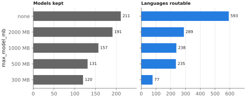

# linguonnx documentation
<!-- agent-hint: the reading order of the docs. Verify the counts: `pytest -q test/test_docs.py`. -->

`linguonnx` identifies the language of a text and translates it on CPU, with
ONNX Runtime and no torch.

<picture>
  <source media="(prefers-color-scheme: dark)" srcset="img/budgets-dark.svg">
  
</picture>

`img/plot_budgets.py` makes this figure from `benchmarks/results.json`, which
`scripts/benchmark.py` writes. [routing.md](routing.md#size-budget) explains
the size budget.

## Quickstart

```python
from linguonnx import load_translator

tx = load_translator()
print(tx.translate("bom dia, como estás?", src="pt", tgt="en"))
# 'Good morning, how are you?'
```

## Pages

| Page | Read it to |
| --- | --- |
| [install.md](install.md) | install the extras, run on a GPU, move the model cache, run the tests |
| [detect.md](detect.md) | identify the language of a text |
| [translate.md](translate.md) | translate a text, and select the target language of each architecture |
| [routing.md](routing.md) | understand how the router selects a model or a chain of models |
| [models.md](models.md) | read the registry, and add a model to it |
| [licences.md](licences.md) | understand the licence tiers, and use a non-commercial model |

## What ships

| | |
| --- | --- |
| Translation registry | 453 entries: 225 int8 and 226 fp32, from 226 models, and 2 rule-based translators |
| Language identification registry | 12 entries |
| Reachable languages | 592 on a base install, 606 with every extra, over the default graph |
| Default LID model | `glotlid-int8`: Apache-2.0, the widest coverage |
| Default translation graph | each int8 or rule-based model that is not non-commercial, fewest hops, at most 2 hops |
| Licences | Apache-2.0, MIT, AFL-3.0, CC-BY-4.0 and CC-BY-SA-4.0 in the default translation graph. CC-BY-NC-4.0 models need `include_noncommercial=True`. The one AGPL-3.0 model is fp32 only, so the default `precision="int8"` keeps it out. OpenLID (GPL-3.0) loads only by name |

## Related projects

- [scriptconv](https://github.com/TigreGotico/scriptconv) identifies the
  writing system (ISO 15924), and converts between phoneme notations and
  scripts. A GlotLID label has a script subtag (`zho_Hans`, `srp_Cyrl`). Use
  scriptconv when you must identify or transliterate the script.
- [ovos-lang-parser](https://github.com/OpenVoiceOS/ovos-lang-parser) converts a
  language name ("Brazilian Portuguese") to a BCP-47 tag, and a tag to a name.
- [phoonnx](https://github.com/TigreGotico/phoonnx) is text to speech on ONNX
  Runtime.
- [onnx-asr](https://github.com/istupakov/onnx-asr) is speech to text on ONNX
  Runtime. `linguonnx` follows its structure.
